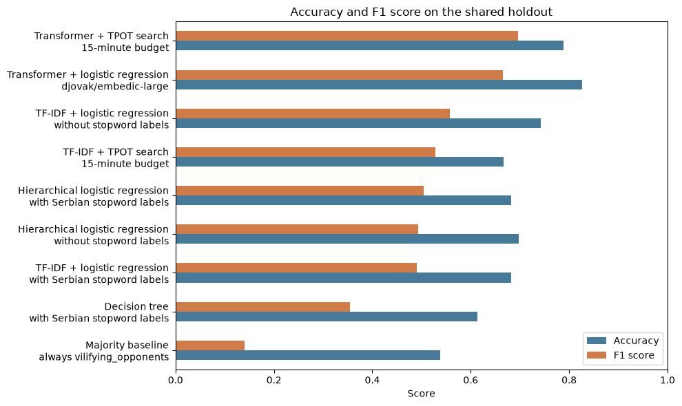
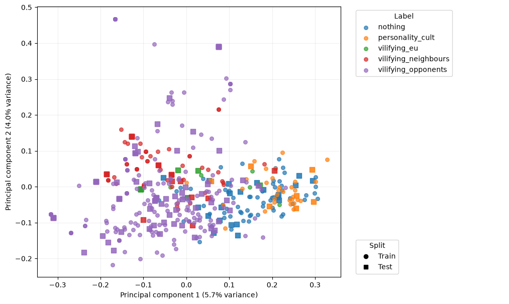
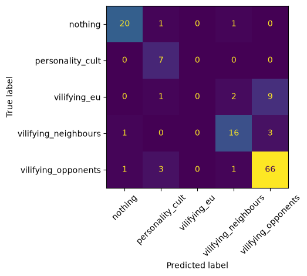
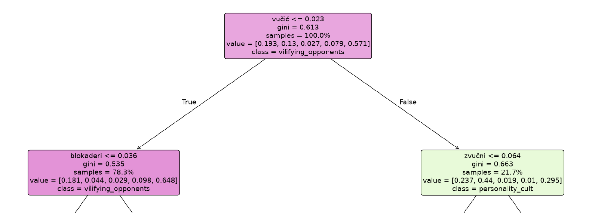
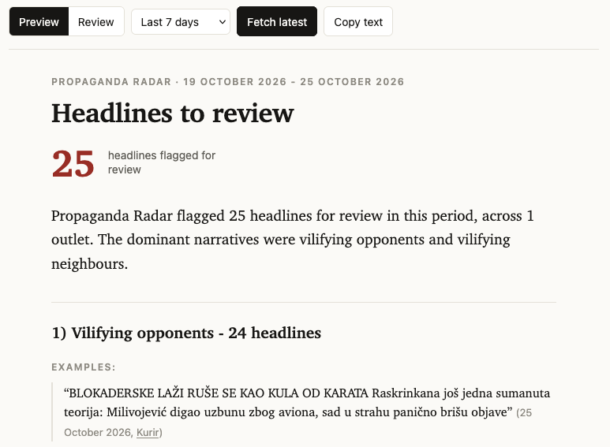
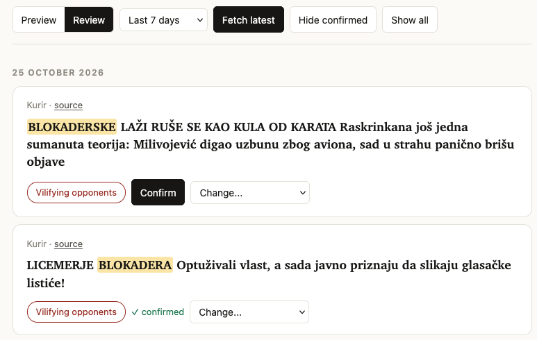

# Technical report: Propaganda Radar

Pro-government outlets dominate the Serbian media landscape and systematically push narratives that favour the ruling party [1]. These outlets often wage smear campaigns against actors deemed hostile to the authorities [2]. On the other hand, their coverage of the authorities is overwhelmingly positive.

The CRTA watchdog organisation monitors the front pages of pro-government media for such manipulations and publishes monthly media manipulation reports [3]. CRTA identifies four categories of media manipulation in Serbia:

1. Vilifying opponents: Coverage shaming the student movement, portraying them as criminals or as wanting to destroy Serbia
2. Vilifying neighbours: Coverage painting neighbouring countries and their leaders as part of a conspiracy against Serbia
3. Personality cult: Coverage praising former president Aleksandar Vučić, framing him as an indispensable political mastermind and his achievements as historic
4. Vilifying the EU: Anti-EU content portraying it as unfriendly to Serbia and opposed to its interests.

While these reports successfully identify patterns in Serbian pro-regime media, they are published too infrequently, and no report has been published since August [3]. Moreover, the headlines appear to be hand-labelled, which is labour-intensive and time-consuming. Additionally, coverage is limited to the front pages and does not extend to the inner pages.

This project aims to develop a web service that automatically identifies and categorises headlines on pro-regime outlet websites using classification algorithms. This approach would enable real-time narrative monitoring and expand the scope of analysis. However, because machine learning models may incorrectly flag some headlines, CRTA’s reports should remain the main source of truth.

The main users of this service would be watchdog organisations in Serbia and foreign policymakers. Since Serbia is due to hold presidential elections this year due to Vučić's resignation, the project could also be used to monitor election integrity during the campaign period.

## Data collection

The headlines for training machine learning models were collected by scraping the politics sections of [Kurir](kurir.rs) and [Informer](informer.rs) portals. Both web pages and RSS feeds were scraped. The data was labelled using Claude Sonnet 5.5, and all labels were verified by a Serbian speaker. A small number of labelled example headlines were collected from CRTA’s website.

The dataset is stored as a CSV file and contains approximately 1300 headlines. The file contains the following columns: headline, label, source (outlet), url and date.

### Preprocessing

A mixture of the Latin and Cyrillic scripts was used in the headlines. All headlines were first normalised to Latin, and diacritic folding was applied. Next, stopwords were removed. However, stopword removal was skipped for the model based on Sentence Transformer embeddings. Finally, the headlines were deduplicated.

### Labelling

- crta 162, llm 287, hand 6.
- 84 of 455 labelled rows are "nothing". Real base rate is 2%.
- 7 of 27 CRTA Kurir rows are multi-label. We forced single.

## Exploratory Data Analysis (EDA)

We didn't receive a data set from CRTA in time for the project, but just from the headlines we labeled ourselves, we could see that there was at least some coverage of all of the labels, and also the share of "nothing" labels wasn't too high: this meant that the categories selected _a priori_ do in fact represent over 80% of the data.

| label                |   count |    % |
|:---------------------|--------:|-----:|
| nothing              |      84 | 18.5 |
| personality_cult     |      38 |  8.4 |
| vilifying_eu         |      19 |  4.2 |
| vilifying_neighbours |      69 | 15.2 |
| vilifying_opponents  |     245 | 53.8 |

This meant we didn't need to add more categories but could safely just use those that we planned. Of course since they came from CRTA, we knew they were "good" in the sense that they were extensively battle-tested in manual processes. What we were unsure about was if they'd be representative of shorter time frame news-feed: some of the labels could be very seasonal or otherwise rarely used just when we would be sampling.

Seasonality is in fact visible in the data: since the election is coming, the propaganda apparatus is in full gear smearing the political opposition, leaving less bandwidth for vilifying the European Union.

But the EDA resulted us being very much satisfied with our current plan and current data collection methods. So: on to analyzing deeper what we got, and building predictive models!

## Modelling

We applied all tools introduced during the course to this classification task. Good thing is, this is very textbook "sentiment analysis": given sentences, we are to classify them into 5 buckets. For encoding the headlines into embedding vectors, we used TF-IDF vectorizers and transformers. For classifying the vectors into label classes, we tried logistic regression, decision trees, and an "automated machine learning" library called [Tree-based Pipeline Optimization Tool (TPOT)](https://epistasislab.github.io/tpot/latest/), introduced in [week 6 exercises](https://courses.mooc.fi/org/uh-cs/courses/introduction-to-data-science/chapter-7/big-data-management#aec7a92f-00ee-4762-9f04-a83f810d5f3b).

### Results

| model                             |   accuracy |   precision |   recall |   f1_score |
|:----------------------------------|-----------:|------------:|---------:|-----------:|
| Transformer + TPOT search         |      0.788 |       0.670 |    0.738 |      0.696 |
| Transformer + logistic regression |      0.826 |       0.628 |    0.728 |      0.666 |
| TF-IDF + logistic regression      |      0.742 |       0.571 |    0.568 |      0.557 |
| TF-IDF + TPOT search              |      0.667 |       0.554 |    0.560 |      0.528 |
| Hierarchical logistic regression  |      0.697 |       0.547 |    0.484 |      0.493 |
| Decision tree                     |      0.614 |       0.384 |    0.356 |      0.355 |
| Majority baseline                 |      0.538 |       0.108 |    0.200 |      0.140 |

There were two kinds of classification ideas: logistic regression and decision trees. TPOT would also produce a pipeline that ended with `SGDClassifier`, a linear classifier like logistic regression with Stochastic Gradient Descent training. Curiously, it would lose to simple `LogisticRegression` with TF-IDF and just barely inch ahead when using the `SentenceTransformer`.

There is certain tradeoff between good scores and interpretability: the most interpretable methods are decision trees and logistic regression with TF-IDF, but the best scores are achieved by using SentenceTransformer embeddings that are opaque to the human eye.

Next I'll detail each technique and the results obtained.

### TF-IDF

[Term frequency minus inverse document frequency](https://en.wikipedia.org/wiki/Tf-idf) (TF–IDF) is a technique that was introduced in [week 2 (MOOC chapter 4) exercises](https://courses.mooc.fi/org/uh-cs/courses/introduction-to-data-science/chapter-4). Quoting Wikipedia, TF minus IDF is "a measure of importance of a word to a document in a collection or corpus, adjusted for the fact that some words appear more frequently in general". Here "document" means simply the headlines we're classifying.

Term frequency means more common words within the document are more important (locally), while **inverse** document frequency means more globally common words between ALL documents are less important. This makes sense: some small words are used everywhere, so they can help very little telling the different headline classes apart. Of course the very most common words are filtered out completely during so-called stopword filtering, already introduced in the [week 1 (chapter 3) exercises](https://courses.mooc.fi/org/uh-cs/courses/introduction-to-data-science/chapter-3).

The good thing about TF-IDF feature vectors is that the words themselves stay as-is, so whatever weights they receive are fully interpretable, even after logistic regression or decision tree modelling.

### Sentence transformer

Transformers were introduced in [chapter 5](https://courses.mooc.fi/org/uh-cs/courses/introduction-to-data-science/chapter-5/deep-learning) and the week 4 exercises. The idea to use them for improved embeddings actually came from the audience feedback during the spotlight session Q&A, so a big thank you to our active audience!

While the transformer produces much richer 1024-dimensional vectors than the simple TF-IDF score, those vectors are also quite impossible to interpret: best we can do is look how our labelled classes are spread in the embedding space:

And it indeed looks very good! Except for the `vilifying_eu` label, the other classes seem neatly linearly separable; indeed, simple linear regression gets them very nicely separated:

### Decision trees

Decision trees were introduced in [chapter 5](https://courses.mooc.fi/org/uh-cs/courses/introduction-to-data-science/chapter-5/predictive-models#ace04a7f-33c1-49ee-81c1-3fdfd5a96c79). The scores for the decision tree model are not the best, but its advantage is interpretability. At the top of the tree we already see two common words: Vučić, and blokaderi (a derogatory term for political opposition and demonstrators).

## The app

We present the headline classification results in a web app inspired by CRTA's monthly media manipulation reports. Users can specify a time period and check the number of headlines in each category.

Labellers can verify AI-labelled headlines. We plan to add support for posting blog posts to the platform. Keywords important to determining a headline's category are highlighted.

The frontend is built with Alpine.js, a lightweight JavaScript framework that enables dynamic updates without a build step. The app reads the data store live, providing real-time updates to the user interface. The backend is implemented using Python's built-in http package to minimise complexity.

## Conclusion

We have delivered an end-to-end data science project covering all stages of the data lifecycle. The data science project canvas taught us how to plan a data project. Scraping multiple websites taught us how to organise data from different sources. During the preprocessing and modelling stage, we got to apply all textual data analysis tools taught during the course. Finally, preparing the spotlight presentation enhanced our ability to convey our ideas and show the value of our work to stakeholders efficiently.

Reflecting on the process: the initial plan held very well. Everything in data collection and analysis went very smoothly, despite us not succeeding in contacting CRTA and getting their hand-labelled datasets. This is understandable: they had more important things to do during the election season. The incumbent president just admitted defeat, so maybe they did their part right!

We hope the tool can be useful to political observers, later elsewhere, since it should be straightforward to adapt to other countries and other pivotal times.

## References
[1] Media Pluralism Monitor 2026, https://cmpf.eui.eu/country/serbia-2026/
[2] CRTA Media and Information Space Page, https://crta.plus/media-information-space/
[3] CRTA Front Page Manipulations Overview, https://crta.plus/media-information-space/front-page-manipulations/
